# Дом своими руками

**Каркасный дом от участка до кровли: проект, расчёт по СП, 3D по этапам и пошаговая инструкция для самостоятельной стройки.**

Нативное приложение для macOS (SwiftUI + SceneKit). Вы рисуете дом мышью или берёте готовый проект, а программа выдаёт полный комплект: фундамент с арматурой, каркас со всеми досками, перекрытия, стропила, утепление и отделку. Плюс схемы узлов с размерами, порядок работ с инструментом и ведомость закупки с ценами. Все размеры подогнаны под стандартные материалы из магазина, поэтому на стройке почти ничего не нужно мерить и резать.

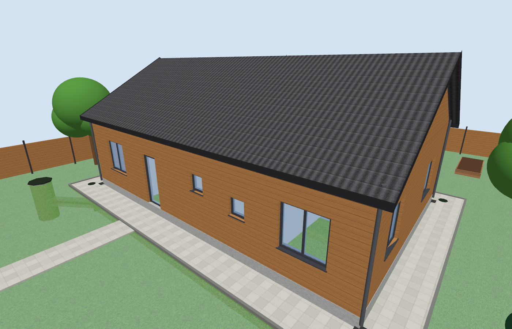

---

## Главная идея: дом из стандартных материалов

Обычно дом рисуют «как хочется», а потом на стройке каждую доску и лист подрезают по месту. Здесь наоборот: размеры дома подбираются под размеры материалов.

| Правило | Почему так |
|---|---|
| **Шаг стоек, балок и стропил — 625 мм** | лист ОСП 1250 = ровно 2 шага, стык всегда попадает на стойку. Плита утеплителя 600 входит в просвет 575 в распор, без подрезки |
| **Стойка — целая доска 3000 мм** | высота каркаса 3150 = 50 (низ) + 3000 + 2×50 (верх). Стойки ставятся как есть, без торцовки |
| **Наружные размеры кратны 1250 мм** | на стену и на пол идёт целое число листов ОСП, доборов нет |
| **По высоте: половинка + целый лист** | ОСП: полоса 625 + лист 2500. ГКЛ: полоса 600 + лист 2500 = 3110 до потолка. Утеплитель: 600 + 1200 + 1200. Если рез нужен, он один: лист или плита пополам, без отходов |
| **Распорка 575 на отметке 600–650** | держит горизонтальный стык ОСП и ГКЛ. Из доски 3000 выходит 5 распорок |
| **Балки и стропила над стойками** | нагрузка идёт по прямой, разметка одна на весь дом (шаблон 625) |
| **Только типовые окна и двери** | блоки по ГОСТ со склада. Проём ставится так, чтобы его стойка совпала с рядовой стойкой, поэтому лишних стоек меньше |

Программа проверяет проект по этим правилам. Кнопка **«Подогнать под стандартные материалы»** одним нажатием приводит размеры, шаг, высоту и проёмы к модулю. Все готовые проекты каталога уже подогнаны.

<table>
<tr>
<td width="50%">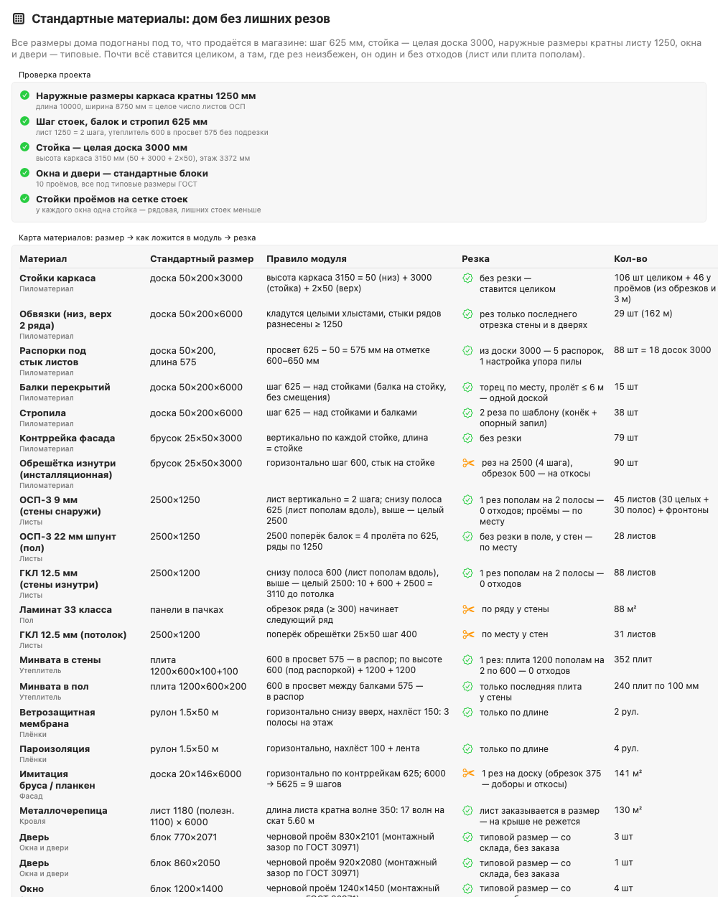<br><sub>Проверка проекта и карта материалов: размер → как ложится в модуль → резка</sub></td>
<td width="50%">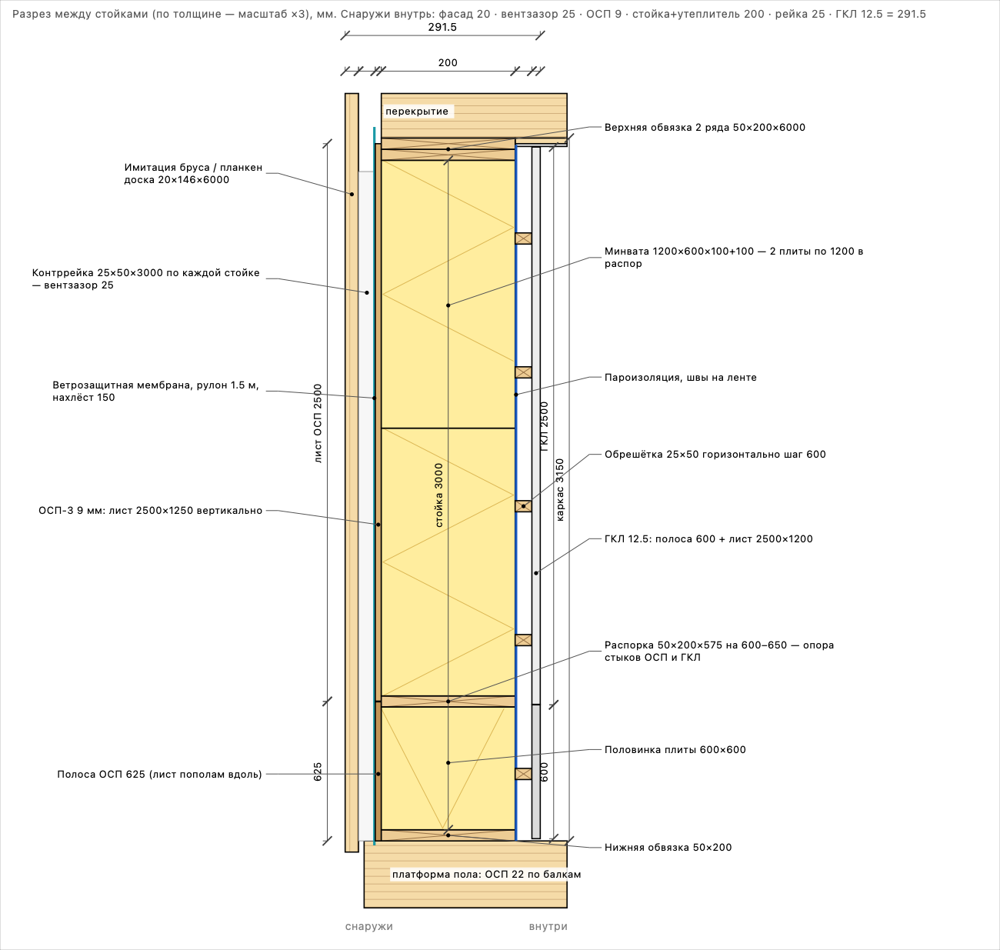<br><sub>Разрез стены: брус, утеплитель, наружная и внутренняя отделка, все размеры в мм</sub></td>
</tr>
</table>

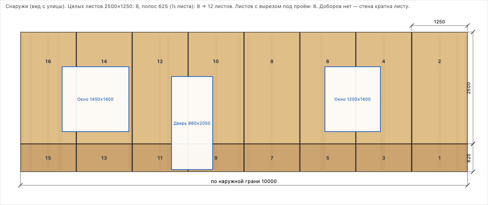
<sub>Раскладка ОСП на стене 10 000 мм: 8 колонок по 1250, целые листы и полосы-половинки, доборов нет</sub>

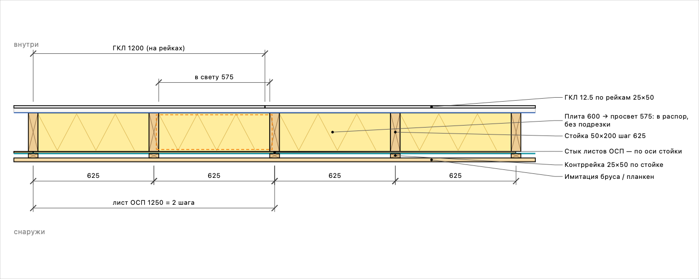
<sub>Стена в плане: шаг 625, плита 600 в просвет 575, стык листов по оси стойки</sub>

---

## Пошаговая инструкция «своими руками»

Проект разбит на этапы (до 27) в том порядке, в каком строят дом: документы и разбивка, земляные работы, опалубка, арматура, бетон и гидроизоляция, приёмка и пропитка материалов, обвязка, балки пола, стены, проёмы, перегородки, перекрытие, стропила, кровля, черновая инженерка, вентиляция, дымоход (если есть печь или котёл на топливе), утепление и фасад, основание пола и тёплый пол, внутренняя обшивка, мокрые зоны, наружные сети (скважина и септик), крыльцо и козырёк, отмостка и дренаж, чистовой пол, чистовая сантехника, сдача дома и эксплуатация. Страница **«Порядок строительства»** показывает все этапы на одном экране: что за чем, когда начинать каждый этап и что нужно решить до начала стройки. В каждом этапе есть:

- **Когда**: после чего начинать и что должно быть готово.
- **Порядок работ** с конкретными размерами вашего дома.
- **Инструмент**: что купить или взять в аренду.
- **Крепёж**: что крепим → какие гвозди или саморезы купить (размер, тип, покрытие) → чем забивать или закручивать (молоток, нейлер, ударный шуруповёрт, бита).
- **«Как сделать»**: подробные пошаговые инструкции с советами. Например, как постелить гидроизоляцию под брус горелкой или без неё, как поставить химический анкер, как соединить брус «в полдерева», как собрать стену лёжа и поднять её на укосины, как прибить ОСП, чтобы стена работала как диафрагма, как уложить минвату без подрезки, как сделать шаблон стропила, как поставить окно по ГОСТ 30971.
- **Принятые решения** с обоснованием и ссылкой на пункт СП или ГОСТ.
- **Схемы и чертежи** узлов с размерами.
- **Материалы этапа** с названиями, как в магазине, количеством и ценой.

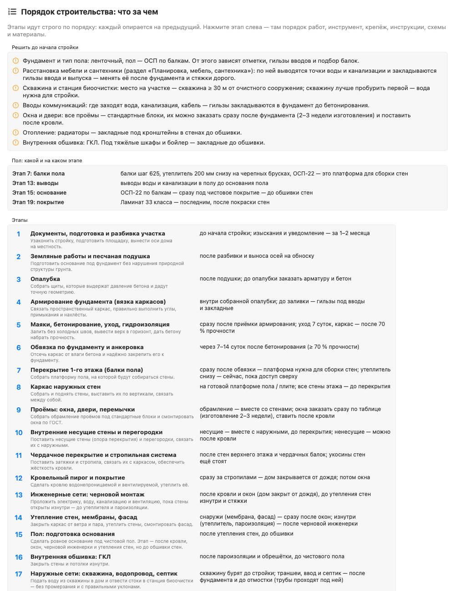
<sub>Порядок строительства: что решить заранее, какой пол на каком этапе, все этапы с подсказкой «когда»</sub>

<table>
<tr>
<td width="50%">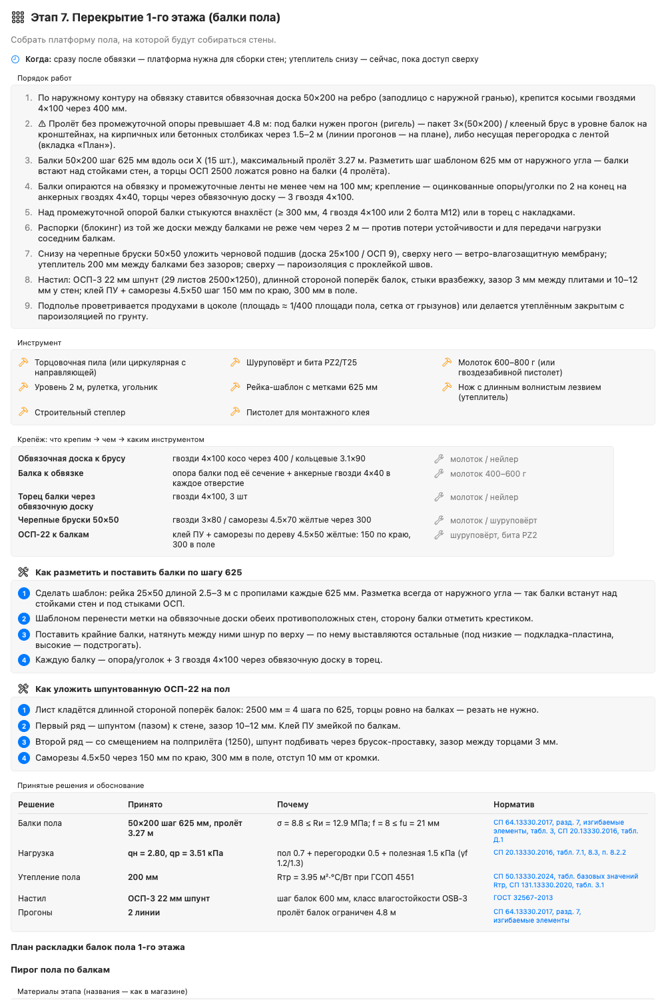<br><sub>Обвязка: инструмент и инструкции, как стелить гидроизоляцию и ставить анкеры</sub></td>
<td width="50%">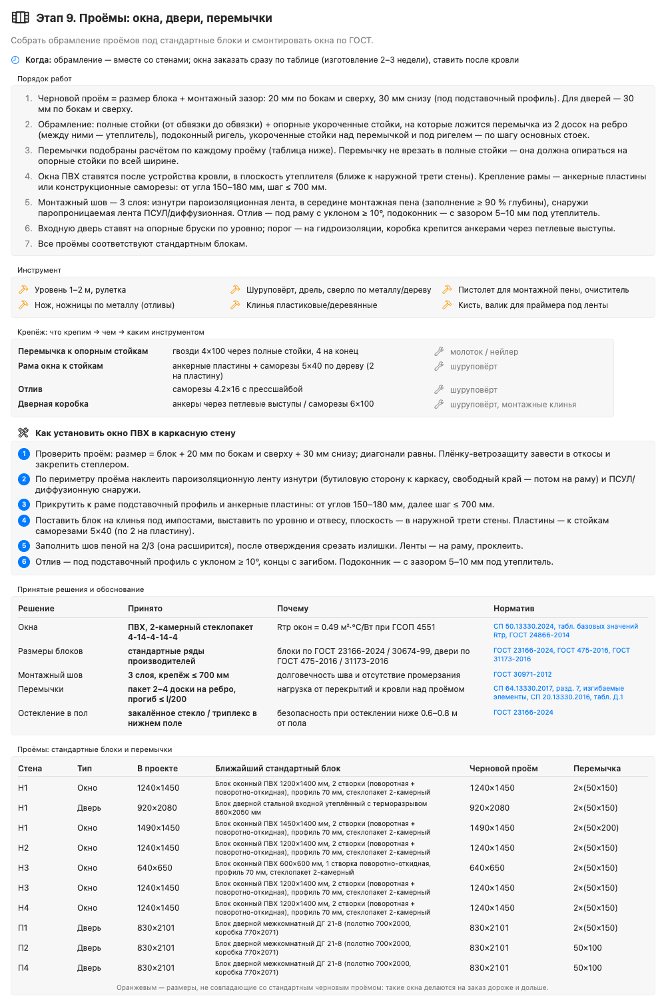<br><sub>Каркас стен: сборка лёжа, подъём на укосины, откуда берётся жёсткость</sub></td>
</tr>
</table>

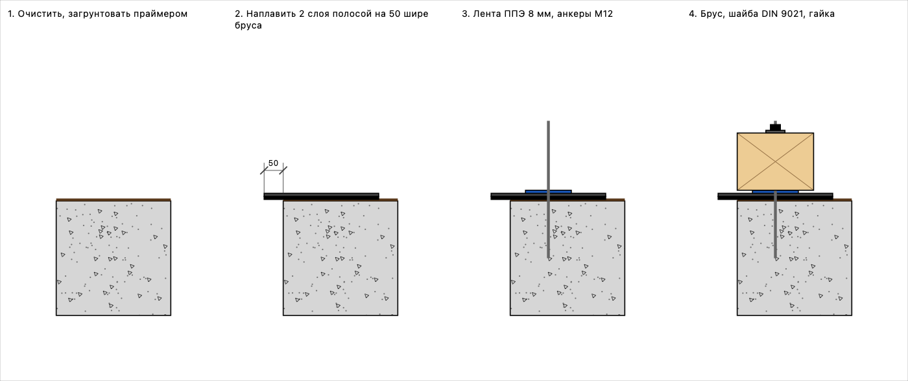
<sub>Что лежит между фундаментом и брусом и в каком порядке это стелить</sub>

### Планировка, мебель и сантехника

Программа сама находит комнаты по стенам и перегородкам и определяет их назначение по площади, окнам и дверям: кухня-гостиная, спальни, санузел, прихожая, котельная, коридор. Тип любой комнаты можно поменять. Затем в каждой комнате расставляются мебель и приборы: кровать с тумбами, шкаф, кухонный гарнитур, холодильник, обеденный стол, диван, ванна или душ, унитаз, раковина, стиральная машина, котёл, бойлер, гидроаккумулятор, коллектор. Мебель ставится вдоль стен, не перекрывает двери, а высокая мебель не встаёт перед окнами.

По расстановке программа выводит:
- **Точки подключения** холодной и горячей воды и канализации у каждого прибора: высота от чистого пола и диаметр (Ø50/Ø110), таблица с номерами.
- **Разводку внутри дома.** Вода идёт лучами PE-Xa 16 от коллекторов ХВ/ГВ, без соединений в полу и стенах. Канализация: Ø110 от унитазов с уклоном 2 %, Ø50 от остальных приборов с уклоном 3 %. Все длины считаются.
- **Ввод воды и выпуск канализации** с точным местом на стене (стена, расстояние от угла, глубина). Гильзы закладываются в фундамент на этапе армирования. Для плиты канализация укладывается под плиту до бетонирования.
- **Наружные сети.** Скважина с кессоном и септик на участке: станция биоочистки, септик с инфильтратором или накопительная ёмкость. Расстояния: скважина — очистное сооружение ≥ 20–50 м по типу сооружения, очистное — дом ≥ 5 м. Программа считает, какой минимальный участок нужен под такую схему.
- **Глубины по нормам.** Водопровод — на 0.5 м ниже промерзания по СП 31, а если это слишком глубоко — на 0.8 м с греющим кабелем. Канализация — по СП 32, с проверкой на утепление.
- **Продольный профиль** канализации от унитаза до септика.
- **Смета:** трубы, коллекторы, фильтры, бойлер, бурение, насос, кессон, гидроаккумулятор, септик, сантехприборы.

<table>
<tr>
<td width="50%">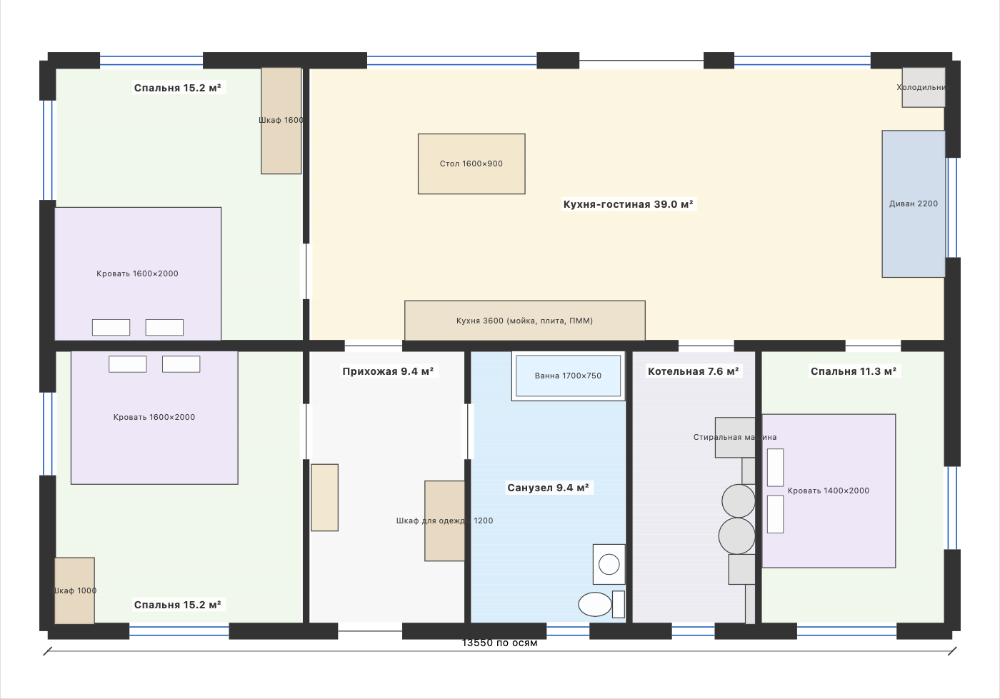<br><sub>Планировка с мебелью и сантехприборами</sub></td>
<td width="50%">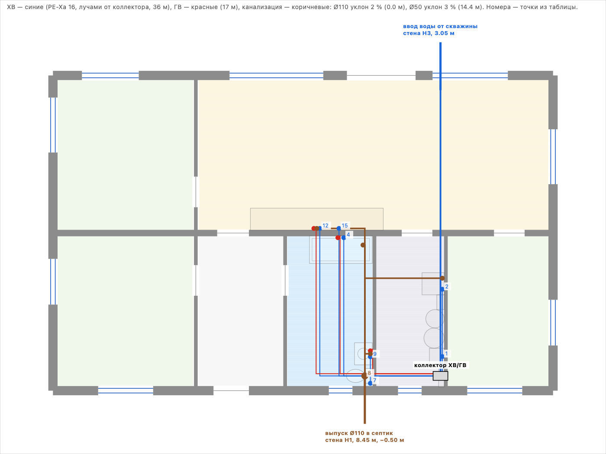<br><sub>Разводка: коллектор, лучи ХВ/ГВ, канализация, ввод и выпуск</sub></td>
</tr>
<tr>
<td width="50%">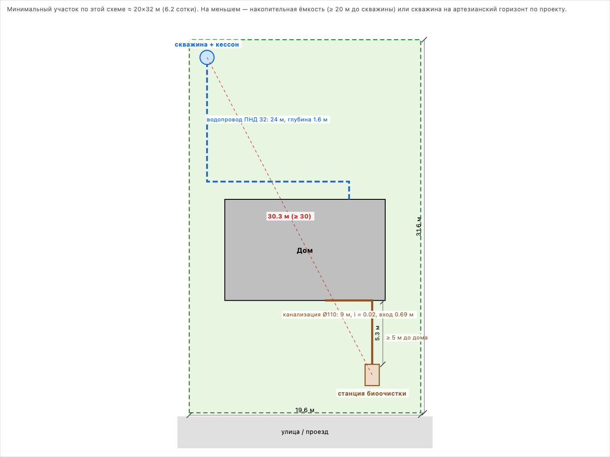<br><sub>Скважина, септик, трассы и расстояния на участке</sub></td>
<td width="50%">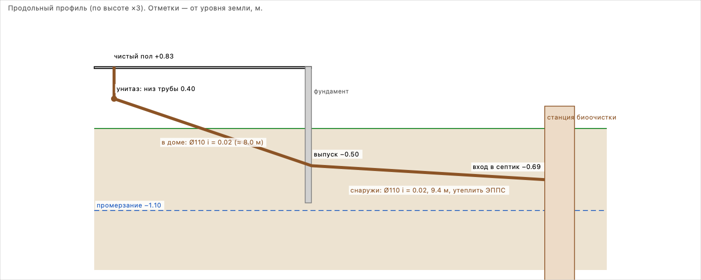<br><sub>Профиль канализации с промерзанием и уклонами</sub></td>
</tr>
</table>

### Пол и тёплый пол

Пол выбирается под фундамент, как обычно делают в каркасных домах:

| Фундамент | Основание пола | Тёплый пол |
|---|---|---|
| **Плита** | полусухая стяжка 65 мм по ЭППС 50 | водяной (трубы PE-Xa в стяжке) или электрический кабель |
| **Плита (УШП)** | трубы прямо в плите, только выравнивающий слой | водяной, трубы вяжутся к арматуре до бетонирования |
| **Лента + балки** | ОСП-22 по балкам, сразу под покрытие | электрическая плёнка под ламинат |
| **Лента + балки** | сухая сборная стяжка ГВЛ 2×10 по ОСП | водяной в панелях с алюминиевыми пластинами, электрический мат под плитку |
| **Лента, пол по грунту** | подготовка + ЭППС 100 + полусухая стяжка | водяной или электрический |

Покрытие на выбор: ламинат, кварцвинил SPC, инженерная доска, керамогранит. Если вариант не подходит (например, мокрая стяжка по деревянным балкам или водяной тёплый пол прямо на ОСП), программа сама заменит его на подходящий и объяснит почему. Вес пола учитывается в подборе балок.

В проекте пол разнесён по этапам:
- трубы в плите — на этапе армирования;
- основание и тёплый пол — после утепления стен, до обшивки;
- покрытие — последним, после покраски стен.

Схема показывает пирог пола с размерами каждого слоя и отметку чистого пола. Для водяного пола есть раскладка петли «улиткой» и расчёт числа петель, метров трубы и коллектора. Всё это с ценами.

<table>
<tr>
<td width="50%">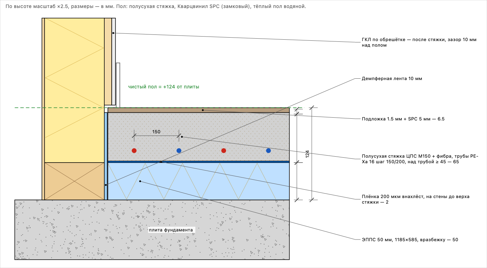<br><sub>На плите: ЭППС, стяжка с трубами, SPC</sub></td>
<td width="50%">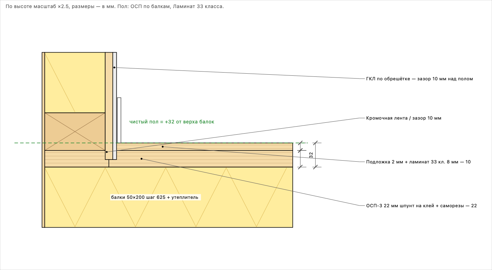<br><sub>По балкам: ОСП-22 и покрытие</sub></td>
</tr>
<tr>
<td width="50%">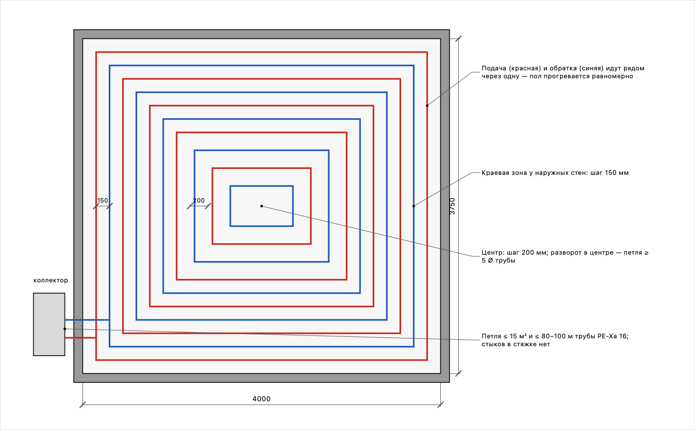<br><sub>Петля водяного тёплого пола «улиткой»</sub></td>
<td width="50%">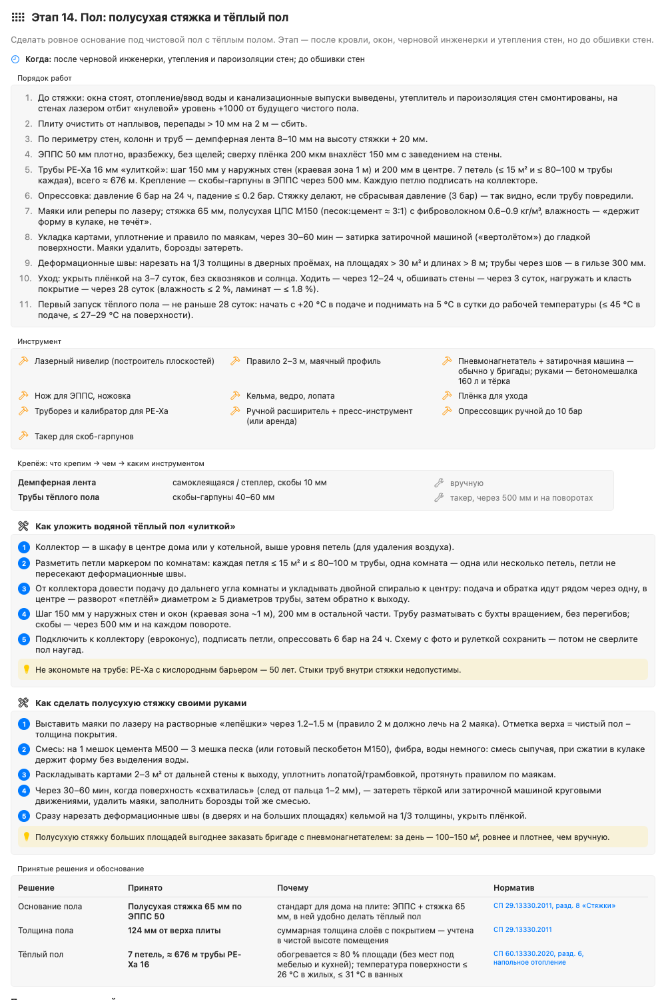<br><sub>Этап «Пол»: порядок, инструмент, крепёж, инструкции</sub></td>
</tr>
</table>

### Соединения и укосины

Отдельный раздел объясняет, **чем и как соединять брус**: таблица из 18 узлов (стойка–обвязка, двойные стойки, перевязка верхней обвязки, балка–обвязка, стропило, ОСП, контррейка, ГКЛ) с указанием крепежа, шага и инструмента.

Там же объясняется, **почему дом не сложится**. Жёсткость каркасу даёт диагональная связь:

- **временные укосины** держат стену при подъёме. Они видны в 3D на этапе стен и отмечены на развёртках;
- **ОСП-3, прибитая по контуру**, работает как сплошной раскос по всей площади стены (диафрагма) и по СП 352 заменяет раскосы;
- **врезные раскосы 25×100** нужны, если снаружи нет ОСП. Можно выбрать вариант «ОСП + раскосы» для максимальной жёсткости;
- **внутренняя отделка** тоже важна. ГКЛ или ОСП, прибитые по контуру, сами держат внутренние стены от перекоса. Вагонка и имитация бруса на кляммерах жёсткости не дают, поэтому при такой отделке программа добавляет врезные раскосы во все внутренние стены. Раскосы видны на развёртках и в 3D, а в этапах объяснено, почему они нужны.

Отдельная инструкция **«Гвозди или саморезы»** объясняет, почему каркас собирают на гвоздях и почему чёрные саморезы для гипсокартона в каркас ставить нельзя. Там же: где нужны конструкционные саморезы, какие гвозди брать под молоток и под нейлер, когда нужен оцинкованный крепёж.

<table>
<tr>
<td width="50%">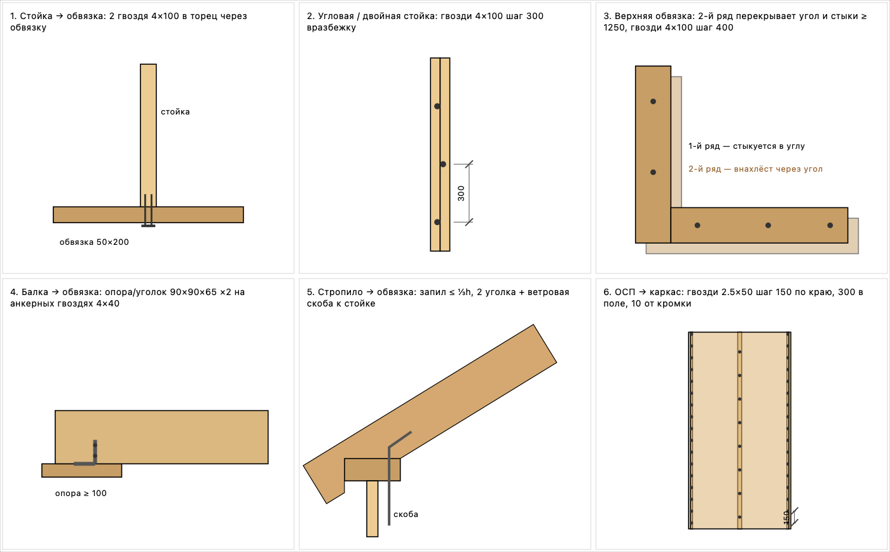</td>
<td width="50%">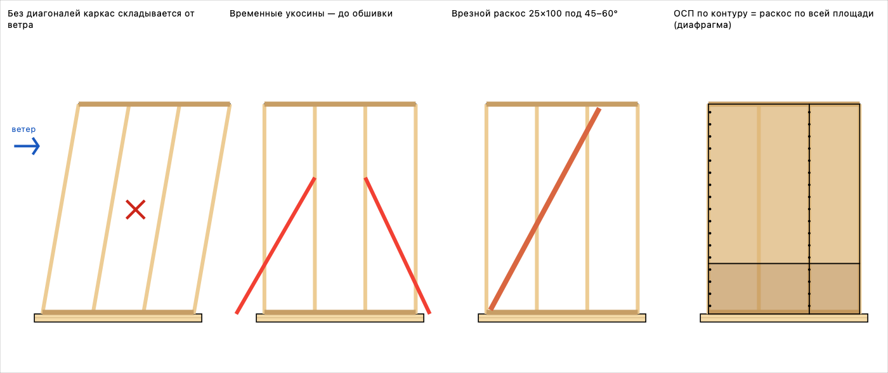</td>
</tr>
</table>

### Защита от влаги, ветра и огня

То, без чего каркасный дом гниёт или эксплуатируется неправильно, вынесено в расчёты и отдельные этапы:

- **Подготовка материалов**: приёмка пиломатериала по влажности (≤ 20 %, влагомер) и сорту, хранение под навесом на прокладках, пропитка ДО сборки по зонам: обвязка и балки пола — трудновымываемая огнебиозащита II группы в 3 слоя, стропила и обрешётка — огнебиозащита II группы, каркас — антисептик, фасадная доска — грунт по всем сторонам. Там же: акклиматизация ОСП, ГКЛ и покрытий пола, УФ-срок мембран, температура применения лент и пены.
- **Пар**: проверка пирога стены и кровли по сопротивлению паропроницанию (внутри в ≥ 5 раз плотнее, чем снаружи) и требуемая Sd пароизоляции. Штукатурный фасад — только минвата и минеральная штукатурка, без ЭППС.
- **Ветер** по СП 20 (ветровой район по городу): отрыв стропил и выбор ветровых скоб, сдвиг и отрыв анкеров обвязки.
- **Кровля**: сквозная вентиляция (перфорированный софит → вентзазор → вентилируемый конёк или аэраторы), ветробарьер у карниза, продухи и утеплённый люк холодного чердака, ендовы и снеговые мешки, проходки, обогрев водостока в снежных районах.
- **Низ стены**: дерево не ниже 300 мм над землёй (плита поднята на 300 мм), боковая гидроизоляция фундамента, отделка цоколя, цокольный отлив с капельником, перфорированная планка вентзазора.
- **Окна**: гидроизоляция подоконной зоны, нахлёст мембраны «черепицей», нащельник над проёмом.
- **Вентиляция**: воздухообмен по комнатам, естественные каналы или ПВУ, приточные клапаны, переток под дверями, утепление каналов.
- **Мокрые зоны**: основание под плитку, обмазочная гидроизоляция, ленты, манжеты, трап, защита от протечек.
- **Безопасность**: противопожарное УЗО, УЗИП, контур заземления, ДУП, молниезащита, разделки дымохода по СП 7, дымовые извещатели.
- **Крыльцо и козырёк** на своих опорах и **календарь обслуживания дома** по сезонам.

---

## Каркас и 3D по этапам

Каждый элемент каркаса генерируется отдельно: обвязка, балки, стойки, распорки, проёмы с перемычками, верхняя обвязка, стропила, контробрешётка и обрешётка. Ползунок в 3D показывает дом на любом этапе стройки. Сечения подобраны расчётом по СП 64 и СП 20: изгиб, прогиб, устойчивость стоек, перемычки над каждым проёмом.

<table>
<tr>
<td width="33%">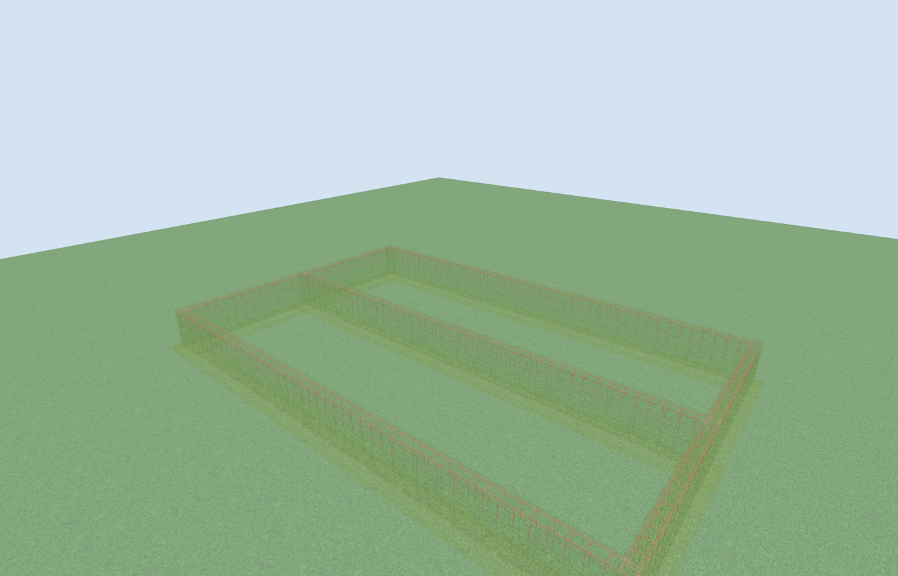<br><sub>Фундамент и арматура</sub></td>
<td width="33%">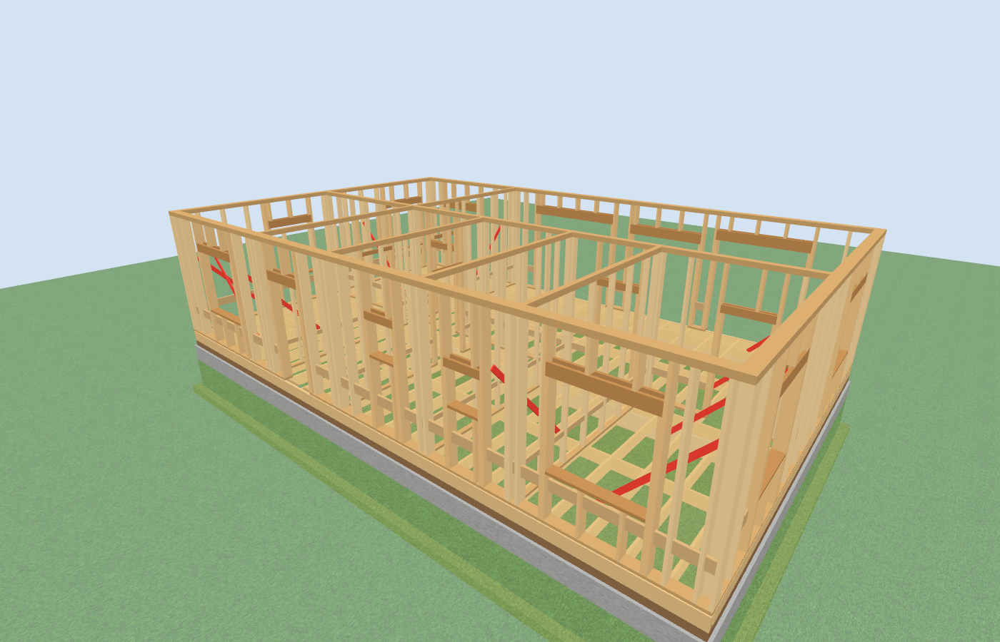<br><sub>Каркас стен с временными укосинами</sub></td>
<td width="33%">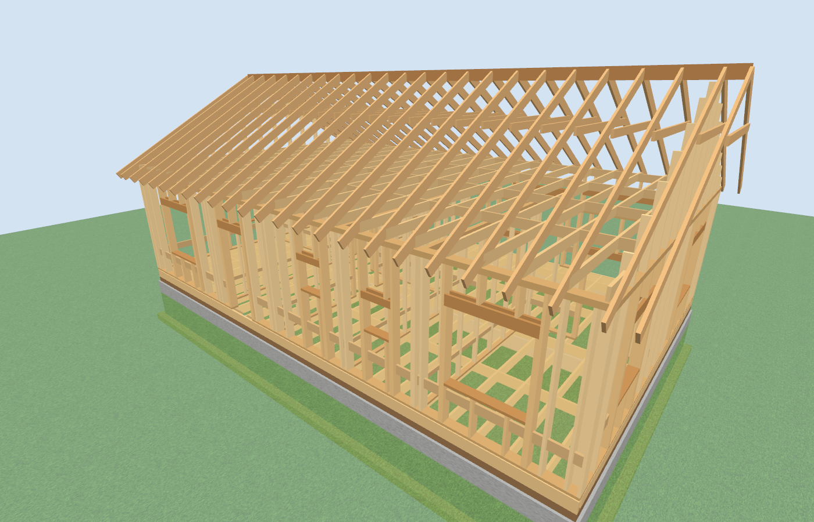<br><sub>Стропильная система</sub></td>
</tr>
</table>

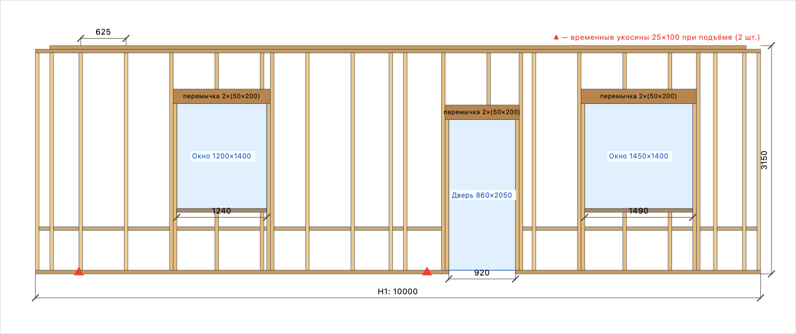
<sub>Развёртка стены: стойки 3000 по шагу 625, распорки, проёмы под стандартные блоки, места укосин</sub>

---

## Фундамент по СП

- **Типы**: ленточный (в том числе мелкозаглублённый), плита, сваи с ростверком (буронабивные, ТИСЭ, винтовые).
- **Нагрузки** по СП 20.13330: стены с фронтонами, перекрытия, кровля, снег (8 районов, μ по уклону), полезная нагрузка, коэффициенты γf.
- **Грунт** по СП 22.13330: 8 типов, R по ф. (5.7), промерзание, осадка послойным суммированием.
- **Арматура**: диаметры, шаг хомутов, нахлёсты, Г-образные стержни в углах, спецификация.
- **Работы**: разбивка с обноской, траншея, подушка, опалубка, вязка, бетон по миксерам, уход, отмостка и дренаж.

## Готовые проекты

13 современных каркасных домов на 73–170 м²: куб с плоской кровлей, дом под вальмой с кирпичной облицовкой, барнхаус, скандинавский, двухэтажный, Г- и П-образные, дом с атриумом. Плюс каталог малых построек — от бюджетных до премиальных: бытовки и дровники (13–22 м²), бани от мини-парной до варианта с комнатой отдыха (13–44 м²), дачные домики квадратной, прямоугольной и угловой планировки (13–52 м²). В каталоге — фильтр по типу постройки, площади, форме и фундаменту. Все проекты собраны из стандартных материалов. После выбора проект можно редактировать: стены перетаскиваются мышью, перегородки рисуются, окна и двери ставятся кликом.

<table>
<tr>
<td width="33%">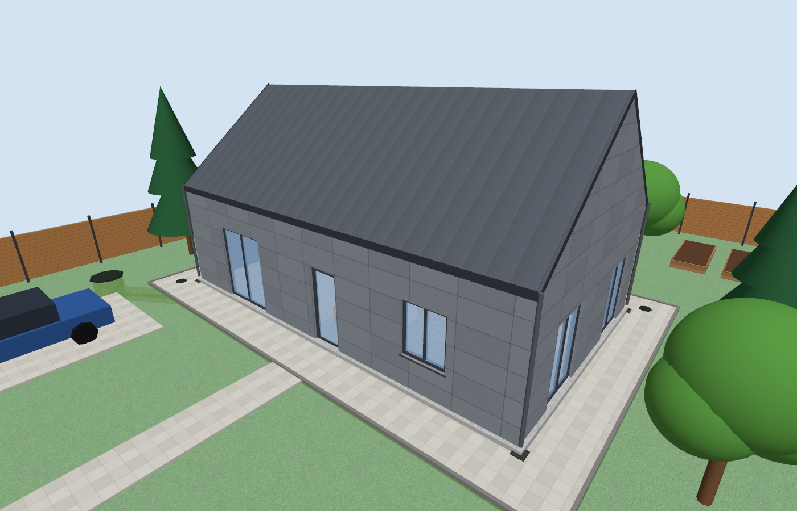<br><sub>Барнхаус 12.5×7.5</sub></td>
<td width="33%">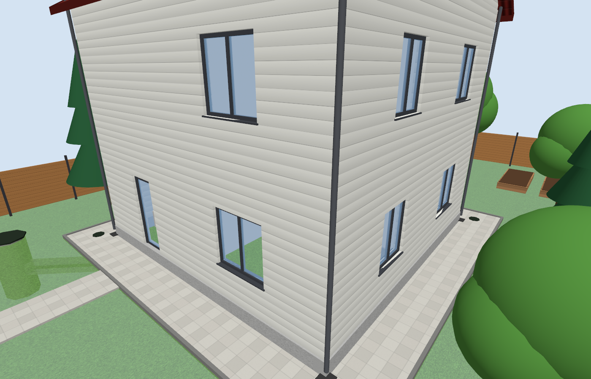<br><sub>Двухэтажный 8.75×8.75</sub></td>
<td width="33%">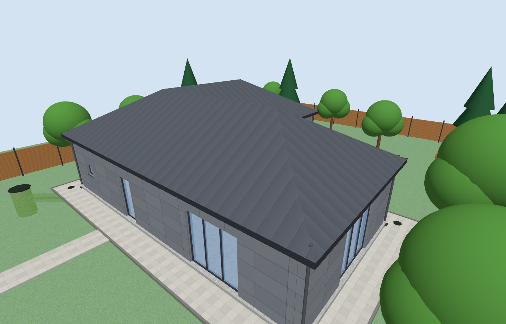<br><sub>Г-образный под вальмой</sub></td>
</tr>
</table>

## Что ещё умеет

- **Теплозащита** по СП 50 и СП 131: требуемое R для стен, кровли, пола и окон по ГСОП вашего города, толщина утеплителя набирается стандартными плитами 50/100 мм.
- **Внутренняя отделка на выбор**: ГКЛ под покраску, вагонка или имитация бруса, шлифованная ОСП. Раскладка листов или досок, крепёж и смета считаются под выбранный вариант.
- **Ведомость пиломатериалов по стандартным длинам**: стойки целыми досками 3 м, короткие элементы из досок 3 м, остальное раскроем хлыстов 6 м.
- **Закупка**: сводная ведомость по отделам магазина (пиломатериалы, листы, утеплитель и плёнки, крепёж, окна и двери, кровля, фасад) с ценами Московского региона. Цены лежат в `Sources/FundamentCalc/Prices.swift`.
- **PDF-проект**: титул с 3D, раздел о стандартных материалах, соединения, все этапы с инструментом, инструкциями, решениями, схемами и материалами, развёртки стен, ведомости, перечень нормативов.
- **Участок в 3D**: забор, газон, деревья, дорожки, парковка, терраса, водостоки, отмостка.

## Сборка и запуск

Нужны macOS 14+ и Command Line Tools (`xcode-select --install`). Xcode не обязателен.

```sh
./build_app.sh                    # собирает «Дом своими руками.app»
open "Дом своими руками.app"
```

## Ограничения

Это предварительный проект для самостоятельного строительства. Характеристики грунтов табличные, ветер считается упрощённо (тип местности B, усреднённые коэффициенты по скату), проверка пара — по соотношению сопротивлений паропроницанию, а не полным расчётом влагонакопления, сейсмика не учитывается, особые грунты (просадочные, набухающие, торф) не поддерживаются, план одинаков для всех этажей, мебель и сантехника расставляются только на 1-м этаже, глубина скважины и расстояния до септика — ориентир (уточняются по местной гидрогеологии и требованиям СанПиН). Перед стройкой нужны инженерно-геологические изыскания и проверка проекта инженером. Цены ориентировочные.

## Отладка

```sh
.build/debug/FundamentCalc --dump                          # текстовый отчёт по фундаменту для всех трёх типов
.build/debug/FundamentCalc --build [--preset id] [--walls] # каркас, сечения, этапы, ведомости; --walls — стойки по стенам
.build/debug/FundamentCalc --build --stage <номер> [--wind 0–7] [--angle °] [--overhang м] [--facade id] [--covering id] [--foundation id] [--cold] [--stove]  # один этап целиком
.build/debug/FundamentCalc --presets                       # проверка всех готовых проектов (модуль, проёмы, фундамент)
.build/debug/FundamentCalc --rooms                         # комнаты, мебель, ввод/выпуск, септик по всем проектам
.build/debug/FundamentCalc --pdf out.pdf [--preset id]     # PDF проекта без окна
.build/debug/FundamentCalc --figs <папка> [--preset id] [--boards] [--water] [--list]  # все схемы проекта в PNG
.build/debug/FundamentCalc --snapshot <папка> [--stages|--ui|--readme]  # 3D-рендеры и экраны; --readme — картинки для этого файла
```
